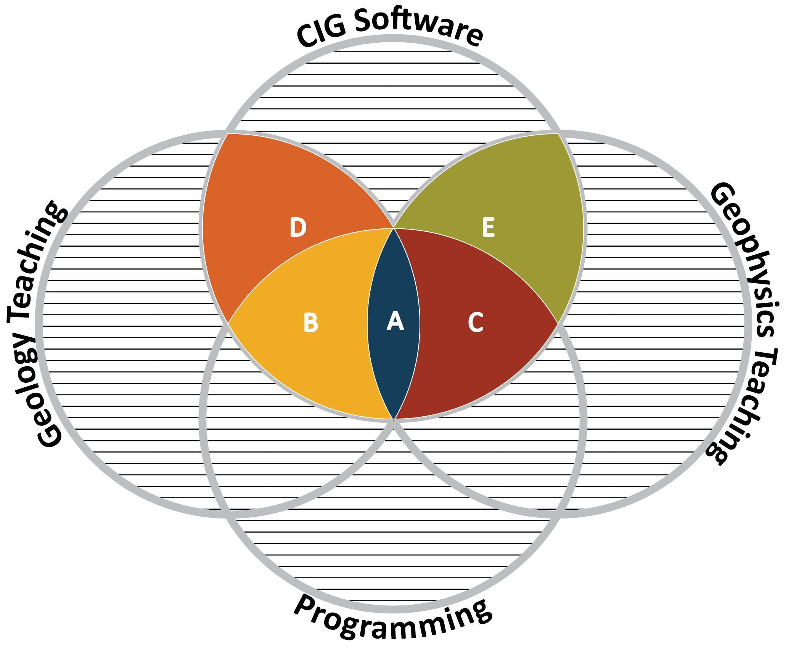

====================
Preface
====================

Background
----------------------------
This project was initiated by the  CIG Education Working Group (`EWG`_), 
which identified significant overlap between geodynamics teaching, programming, and CIG software.
At that time, the group recognized traditionally,
teaching has been organized along two paths. 
The geology path focuses on qualitative to semi-quantitative understanding of Earth and planetary processes, 
where students encounter the governing equations but are not expected to solve them. 
The geophysics path is more quantitative, requiring a strong physics background and emphasizing deriving and solving those equations.

This module is aimed at the quantitative path. Specifically, it covers how Machine Learning and AI techniques can be applied to geoscience. It is intended as an introduction for students who are not yet familiar with ML/AI techniques.

graduate and postgraduate programs.

Topics covered
----------------------------

.. table:: 
    :widths: auto
    :align: center

    +-----------------------------+-------------------------------------------------------------+
    | Modules                     | Topics                                                      |
    +=============================+=============================================================+
    | Introductory Concepts       | - Supervised & Unsupervised Machine Learning                |
    |                             | - Typical Steps in Machine Learning Workflows               |
    |                             |                                                             |
    |                             |                                                             |
    |                             |                                                             |
    |                             |                                                             |
    |                             |                                                             |
    |                             |                                                             |
    +-----------------------------+-------------------------------------------------------------+
    | Dimensionality Reduction    | - Principal Component Analysis on geochemical data          |
    |                             | - Manifold Learning                                         |
    |                             |                                                             |
    |                             |                                                             |
    +-----------------------------+-------------------------------------------------------------+
    | Regression                  | - Linear Regression                                         |
    |                             | - Polynomial Regression                                     |
    |                             | - Random Forest                                             |
    +-----------------------------+-------------------------------------------------------------+

Notebook Structure
--------------------

Each notebook covers the a machine learning / ai technique and works through examples applying that topic to a problem in the geosciences. 

Notebook template
^^^^^^^^^^^^^^^^^^^^^^
The typical notebook should include:

1. Summary section, to introduce the ML/AI topic and the governing physics equations.

2. Analytical section, where the governing equations of the concept are solved/modeled  analytically. This would allow the student to acquire and apply pythonic skills.

3. Numerical  section, where the ML/AI topic is addressed numerically in the context of the geosciences. This would allow the student to acquire and apply machine learning / ai skills.

Development strategy
----------------------------

.. figure:: ../../../assets/dev-strategy.png
    :width: 100%
    :align: center

The development of these notebooks will consist of three distinct steps:

1. **Drafting:** an outline of the notebook will be made capturing the content of each of the above-mentioned sections. The draft will be shared with the Education Working Group (EWG) for feedback.

2. **Finalization:** the notebook will be finalized based on the feedback provided by the EWG. 

3. **Testing:** the finalized notebook is tested and, upon EWG approval, released.

The development timeline will be topic-dependent and should be assessed on a case-by-case basis. For instance, the heat flow notebook (foundation level) took ca. 10 weeks to develop:

- Drafting: 1 week.
- EWG feedback: 4 weeks (this could be reduced down to 1-2 weeks and will depend on the EWG availability and engagement).
- Finalization: 2 weeks.
- Testing: 3 weeks (like the initial feedback phase, this will depend on the EWG availability and engagement).

Education Working Group
----------------------------
The Education Working Group (`EWG`_) works to promote access to educational materials for geodynamics. The EWG advances the infrastructure and content needed to develop a computationally skilled workforce and increase discovery of the discipline. This is achieved through integrating computation with domain science in upper division and graduate level learning.

**Committee members:**

- Juliane Dannberg (Geomar Helmholtz Centre for Ocean Research Kiel)

- Mohamed Gouiza (University of Leeds)

- Adam Holt (University of Miami)

- Lorraine Hwang (University of California, Davis)

- Gabriele Morra (University of Louisiana at Lafayette)

- John Naliboff (New Mexico Tech)

- Max Rudolph (University of California, Davis)

- Sarah Stamps (Virginia Tech)

- Iris van Zelst (German Aerospace Center, DLR)

.. _EWG: https://geodynamics.org/groups/education
