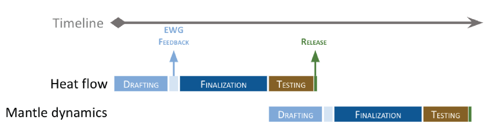

====================
Preface
====================

Background
----------------------------
This project originated from discussions at the CIG Community Workshop 2025, where researchers identified a clear need to introduce machine learning concepts with applications to solid Earth problems in particular. Many geoscientists want to apply ML in their research but lack accessible resources for learning which ML methods suit geoscientific problems and how to use them. These modules aim to close that gap by teaching core ML concepts through geoscience examples.

This module is aimed at the quantitative path. Specifically, it covers how Machine Learning and AI techniques can be applied to geoscience. It is intended as an introduction for students who are not yet familiar with ML/AI techniques.

Topics covered
----------------------------

.. table:: 
    :widths: auto
    :align: center

    +-----------------------------+-------------------------------------------------------------+
    | Modules                     | Topics                                                      |
    +=============================+=============================================================+
    | Introductory Concepts       | - Supervised & Unsupervised Machine Learning                |
    |                             | - Typical Steps in Machine Learning Workflows               |
    |                             |                                                             |
    |                             |                                                             |
    |                             |                                                             |
    |                             |                                                             |
    |                             |                                                             |
    |                             |                                                             |
    +-----------------------------+-------------------------------------------------------------+
    | Regression                  | - Linear Regression                                         |
    |                             | - Polynomial Regression                                     |
    |                             | - Random Forest                                             |
    +-----------------------------+-------------------------------------------------------------+
    | Dimensionality Reduction    | - Principal Component Analysis on geochemical data          |
    |                             | - Manifold Learning                                         |
    |                             |                                                             |
    |                             |                                                             |
    +-----------------------------+-------------------------------------------------------------+

Notebook Structure
--------------------

Each notebook covers an ML/AI technique, and works through examples applying that topic to a geoscience problem. 

Notebook template
^^^^^^^^^^^^^^^^^^^^^^
The typical notebook should include:

1. Summary section, to introduce the ML/AI topic and the governing physics equations.

2. Analytical section, where the governing equations of the concept are solved/modeled  analytically. This would allow the student to acquire and apply pythonic skills.

3. Numerical  section, where the ML/AI topic is addressed numerically in the context of the geosciences. This would allow the student to acquire and apply ML/AI skills.

.. figure:: ../../../assets/nb_template.png
    :width: 100%
    :align: center

Development strategy
----------------------------

The development of these notebooks will consist of three distinct steps:

1. **Drafting:** an outline of the notebook will be made capturing the content of each of the above-mentioned sections. The draft will be shared with the Education Working Group (EWG) for feedback.

2. **Finalization:** the notebook will be finalized based on the feedback provided by the EWG. 

3. **Testing:** the finalized notebook is tested and, upon EWG approval, released.

The development timeline will be topic-dependent and should be assessed on a case-by-case basis. For instance, the heat flow notebook (foundation level) took ca. 10 weeks to develop:

- Drafting: 1 week.
- EWG feedback: 4 weeks (this could be reduced down to 1-2 weeks and will depend on the EWG availability and engagement).
- Finalization: 2 weeks.
- Testing: 3 weeks (like the initial feedback phase, this will depend on the EWG availability and engagement).
